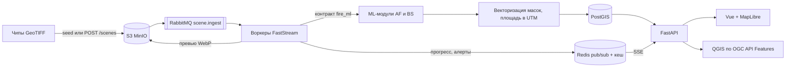

# Кордон - мониторинг природных пожаров по данным ДЗЗ

Решение кейса КосмоХакатона 2026 «Двухэтапный мониторинг природных пожаров». В репозитории два ML-модуля (активное горение по VIIRS, гари и степень поражения по Sentinel) и информационно-аналитический сервис поверх них: карта термоточек, векторные контуры гарей, справка с площадями по степеням, REST API и OGC API Features.

## Запуск сервиса

Нужен Docker с Compose. Выданный архив распакуйте в `DATA/`:

```bash
unzip "Мониторинг DATA.zip" -d DATA/
tar -xf "DATA/Мониторинг DATA/fire-train-renamed.tar" -C DATA/
```

Получится `DATA/train/` с каталогами `af/` и `bs/` внутри — это и есть путь по умолчанию. Другая раскладка задаётся переменной `DATA_PATH`.

```bash
docker compose up --build
```

Интерфейс откроется на http://localhost:8080, Swagger на http://localhost:8000/docs. Если порты заняты, поменяйте `WEB_PORT` и `API_PORT` в `.env` (шаблон в `.env.example`).

При первом старте контейнер `seed` загружает чипы в S3 и ставит сцены в очередь. Сцены появляются на карте по мере обработки, ждать конца не нужно. На 4 воркерах (12 ядер, 16 ГБ) весь набор из 420 AF и 224 BS чипов проходит примерно за 5 минут: AF-сцена занимает около 0,2 с, BS-сцена около 1,8 с. Повторный `up` готовые сцены пропускает. Чтобы проверить сервис быстрее, ограничьте сид: `SEED_LIMIT_AF=24 SEED_LIMIT_BS=16`.

Без каталога с данными сервис стартует пустым, чипы можно загрузить через интерфейс (кнопка «Конвейер») или `POST /api/v1/scenes`.

## Как устроен конвейер



Воркер получает сцену из очереди, скачивает растры из S3, вызывает модель, превращает маску в полигоны и пишет результат в PostGIS. Ход каждого задания уходит в Redis и по SSE в интерфейс. После AF-сцены пересчитываются постоянные источники тепла и проверяются зоны наблюдения.

## Что умеет сервис

Запрос задаётся полигоном или прямоугольником плюс интервалом дат. Территорию можно выбрать из списка регионов, нарисовать на карте или назвать текстом агенту («гари в Калмыкии за июнь 2019»).

- Карта термоточек за период. Отфильтрованные срабатывания остаются видны серыми кольцами с причиной: застройка по WorldCover, солнечный блик или постоянный источник («горит в 17 из 18 пролётов за 6 лет»). Размер пятна несёт мощность излучения очага.
- Мощность излучения пожара, FRP, в мегаваттах у каждой термоточки и суммарно по запросу, плюс список самых мощных очагов по суткам.
- Выбросы в атмосферу: сгоревшая биомасса, CO₂, угарный газ, метан, PM2.5 и общий CO₂-эквивалент.
- Профиль территории за все годы: межгодовой ход с отклонением от среднего, сезонность по месяцам, ядро пожарного сезона и повторяемость горимости.
- Контуры гарей и полигоны степеней поражения поверх подложки, выгрузка в GeoJSON, Shapefile, GeoPackage и KML. Атрибуты: идентификатор контура, степень, площадь в гектарах, даты съёмки, система координат расчёта.
- Справка: суммарная площадь, распределение по трём степеням и по типам покрова, число очагов, доля отфильтрованных срабатываний, погода в момент детекции. Форматы JSON, CSV, XLSX, PDF.
- Паспорт территории в каждой выгрузке: название местности, охваченные субъекты РФ с долями, координаты, площадь запроса и доля, покрытая данными. Выводится из геометрии запроса, поэтому одинаков в интерфейсе и в ответе REST API. PDF дополнительно несёт обзорную карту с границей мониторинга, контуром запроса и пятью крупнейшими гарями.
- Сравнение снимков «до» и «после» шторкой: видимый диапазон, SWIR, радар Sentinel-1, dNBR, наложение степеней.
- [Паспорт пожара](docs/fire-passport.md): термоточки и гарь в одной истории, объяснение предполагаемой связи, степени поражения, предварительное восстановление и JSON. Открывается из сводки или кликом по объекту на карте.
- Проигрывание периода по дням на шкале времени.
- Метрика кейса `Score = 0.35*F1_af + 0.35*IoU_burn + 0.30*mIoU_sev` прямо в интерфейсе, с микро-усреднением по сценам запроса, для которых есть эталонная маска. Удобно смотреть, где модель ошибается по территории.
- План лесовосстановления по степени и типу покрова: сколько гектаров восстановится само, сколько требует посадок и входит в расчёт ущерба. Ставки в `backend/src/firewatch/assets/restoration_rules.json` условные, замените региональными.
- Зоны наблюдения: новая термоточка природного пожара в зоне даёт алерт в интерфейсе и POST на webhook.
- План реагирования по свежим очагам: приоритет от 0 до 100, прогноз фронта на 1, 3 и 6 часов, населённые пункты на его пути, ближайшая пожарная часть со временем подъезда, способ тушения и силы. Подробности в разделе «План реагирования».
- Анализ произвольной области: выбираете точку, очаг из архива или свой полигон и две даты, сервис скачивает Sentinel-2 L2A из открытого каталога, собирает чип в формате кейса и прогоняет через ту же модель гарей. Подробности в разделе «Снимки со спутника».

## REST API

Полное описание в Swagger. У каждого аналитического ресурса две формы: `GET` с `bbox` и `POST` с полигоном GeoJSON.

| Метод и путь | Что возвращает |
|---|---|
| `POST /api/v1/query` | термоточки, контуры гарей и справка одним ответом |
| `GET, POST /api/v1/hotspots` | термоточки, `format=geojson,csv`, фильтр `kind` |
| `GET, POST /api/v1/burns` | контуры (`layer=contours`) или степени (`layer=severity`), `format=geojson,shp,gpkg,kml` |
| `GET, POST /api/v1/report` | справка, `format=json,csv,xlsx,pdf`; `tz_offset` — пояс выгрузки в минутах, по нему подписано время в шапке PDF |
| `GET, POST /api/v1/profile` | профиль территории за все годы: годы, сезонность, повторяемость горимости |
| `GET, POST /api/v1/response-plan` | план реагирования по свежим очагам, `external.osm=pending` значит, что окружение ещё дозапрашивается |
| `POST /api/v1/scenes` | загрузка чипа, ответ содержит `job_id` |
| `POST /api/v1/acquisitions` | скачать Sentinel-2 по полигону и двум датам, собрать до 4 чипов и поставить в конвейер |
| `GET /api/v1/acquisitions/suggest` | подсказка области: `mode=random` или `mode=fire` (очаг из архива) |
| `GET /api/v1/stream` | SSE: задания конвейера и алерты |
| `GET /api/v1/metrics/quality` | метрика кейса по всем сценам с эталоном |
| `GET /api/v1/tiles/burns/{z}/{x}/{y}.mvt` | векторные тайлы гарей; `clip` — id региона или `p:lon,lat;...`, отдаёт только гари выбранной области |
| `/ogc` | OGC API Features: `hotspots`, `burn_contours`, `burn_severity` |

```bash
# справка по прямоугольнику за сезон 2020
curl "http://localhost:8000/api/v1/report?bbox=44,45.5,47,48.5&date_from=2020-04-01&date_to=2020-10-31"

# контуры гарей по полигону в Shapefile
curl -X POST "http://localhost:8000/api/v1/burns?format=shp" -o burns.zip \
  -H "Content-Type: application/json" \
  -d '{"geometry":{"type":"Polygon","coordinates":[[[44,45.5],[47,45.5],[47,48.5],[44,48.5],[44,45.5]]]},"date_from":"2020-04-01","date_to":"2020-10-31"}'
```

В QGIS: Слой - Добавить слой - WFS / OGC API Features, адрес `http://localhost:8000/ogc`. Слои фильтруются по `bbox` и `datetime` на стороне сервера.

## Как считается площадь

Маска векторизуется по границам пикселей без упрощения, в метрической проекции чипа (EPSG:32637 или EPSG:32638). Поэтому площадь контура равна числу пикселей, умноженному на 0,04 га, и справка сходится с растром. Это закреплено тестом `backend/tests/test_vectorize.py`. Контур на границе запроса обрезается, площадь пересечения пересчитывается в той же UTM-зоне. Гарь попадает в период, если интервал между снимками «до» и «после» пересекается с интервалом запроса.

## Как определяется территория справки

Справку читают отдельно от интерфейса: её печатают, пересылают и подшивают. Поэтому
«какая это местность» документ должен отвечать сам, а не ссылкой на то, что было выбрано
на экране. Название региона в запрос не передаётся и передаваться не может: REST-клиент
шлёт только геометрию и даты, и результат обязан совпадать с тем, что вернул интерфейс.

`backend/src/firewatch/services/territory.py` выводит территорию из самой геометрии:
сравнивает её с границей мониторинга и с границами субъектов из `firewatch/assets`. Если
фигура совпадает с эталонной границей по IoU не ниже 0,97, территория называется её
именем («Ростовская область», «Нижнее Поволжье и Подонье»). Иначе запрос описывается
как прямоугольник или произвольный полигон, а в перечень попадают субъекты, занявшие
хотя бы 1% запроса или 1% собственной площади, с долей каждого.

Площади пересечений считаются геодезически на эллипсоиде WGS 84 (`pyproj.Geod`), а не
в градусах: на широте 50° градус долготы почти вдвое короче градуса широты, и доли,
посчитанные по плоским координатам, были бы смещены.

Отдельно считается доля запроса, попавшая внутрь границы мониторинга. Прямоугольник
шире этой границы даёт площадь больше, чем покрыто данными, и справка говорит об этом
прямо, а не выдаёт нули за пределами охвата.

## Мощность излучения пожара

Яркостная температура говорит, насколько горячо в пикселе, но не говорит, насколько сильно горит: слабый жаркий очаг и большой тлеющий пал могут дать близкую температуру. Мощность излучения, FRP, отвечает на второй вопрос, и во всех оперативных системах (FIRMS, EFFIS, GWIS) это основной атрибут термоточки.

Считается методом MIR-radiance (Wooster et al., 2003), тем же, что в продуктах MODIS Collection 6 и VIIRS:

```
FRP = A * sigma / a * (L_f - L_bg)
```

`A` - площадь пиксела, `sigma` - постоянная Стефана-Больцмана, `a` - коэффициент сенсора в аппроксимации `L_MIR = a * T^4`, для VIIRS 2,88e-9 (Li et al., 2018). Спектральная яркость восстанавливается из яркостной температуры канала I4 по формуле Планка. Фон - медиана I4 в окне 21x21 вокруг пиксела; окно расширяется, пока не наберёт чистых пикселов, а все термоаномалии из фона исключаются, иначе крупный пожар занижает сам себя. Реализация и пороги: `backend/src/firewatch/pipeline/frp.py`, проверка формулы - `backend/tests/test_frp.py`.

Выше 367 K канал I4 насыщается, и FRP такого пиксела становится оценкой снизу. Сервис помечает такие точки полем `frp_saturated` и считает их долю в справке. На выданном наборе насыщенных пикселов нет: максимум I4 равен 358 K.

## Выбросы в атмосферу

Схема принята в GFED и Copernicus GFAS, на которых считает выбросы GWIS:

```
сгоревшая биомасса = площадь * запас горючего материала * полнота сгорания
выброс вещества    = сгоревшая биомасса * эмиссионный фактор
```

Запас берётся по типу покрова ESA WorldCover, полнота сгорания - по степени поражения: слабая гарь сжигает подстилку, сильная уносит полог целиком. Площади в разбивке «степень x покров» уже лежат в таблице `scar_landcover`, поэтому выбросы считаются из готовых чисел, без обращения к растрам. Считаются CO₂, CO, CH₄ и PM2.5, а также CO₂-эквивалент с потенциалом метана 27,9 по IPCC AR6.

Таблицы условные, типовые по литературе, и заменяются региональными в `backend/src/firewatch/assets/emission_factors.json`. Точная цифра требует наземной таксации, порядок величины метод даёт верный.

## Профиль территории

Справка отвечает на вопрос «что горело в этот период». Профиль отвечает на другой: типичен ли этот период для территории. Поэтому `/api/v1/profile` период запроса не фильтрует, а только подсвечивает, а считает по всем годам в базе - как «Country Profile» в GWIS.

Повторяемость горимости считается по ячейкам сетки VIIRS 375 м: в скольких разных годах ячейка попадала в природную термоточку. Ячейка, горевшая в 2 и более годах, - место, которое горит из года в год, а не случайно. Ядро пожарного сезона - самый короткий отрезок подряд идущих месяцев, на который приходится 80% термоточек; отрезок может переходить через новый год.

## План реагирования

Для МЧС сервис переводит термоточки в порядок действий. Очаг - кластер природных термоточек одних суток ближе 1,5 км друг к другу. План строится по последним трём дням периода, в которые спутник видел горение, и по восьми самым опасным очагам.

Скорость фронта считается по эмпирическим правилам, выведенным на сотнях реальных пожаров: около 10 % скорости ветра для леса и кустарника (Cruz, Alexander, 2019) и около 20 % для травы и стерни (Cruz и др., 2022). Правила описывают сухие условия, поэтому при влажности воздуха от 20 до 60 % скорость плавно снижается до 15 % от сухой. Ветер и влажность у точки уже есть из ERA5-Land, направления ветра в данных кейса нет, его берём из Open-Meteo на час пролёта. Из скорости и направления строится эллипс возможного выгорания: вытянут по ветру, тыл идёт в десять раз медленнее фронта, вытянутость растёт с ветром.

Приоритет складывается из шести частей: мощность FRP, размер очага, рост за сутки, погода, горючесть покрова и близость населённых пунктов. Сёла, дороги, пожарные части и водоёмы берутся из OpenStreetMap. Публичный Overpass отвечает от секунды до минуты, поэтому план возвращается сразу, а окружение подтягивается в фоне и кешируется на неделю. Пока оно в пути, интерфейс переспрашивает план.

Способ тушения выбирается по покрову и интенсивности. Слабый травяной пал тушат прямо по кромке. Быстрый травяной фронт останавливают опашкой и отжигом. Низовой лесной пожар тушат прямо. Мощный лесной пожар или лесной пожар в сильный ветер останавливают заградительными полосами, отжигом и авиацией. В плавнях работают отжигом от водных рубежей. Все пороги и тексты лежат в `backend/src/firewatch/assets/response_rules.json`. Это поддержка решения, а не приказ: решение о силах и средствах остаётся за руководителем тушения.

## Снимки со спутника

Постановка допускает работу только на выданных сценах. Живой режим показывает, что конвейер не привязан к ним. Чип собирается из открытых данных без авторизации:

- Sentinel-2 L2A из каталога Earth Search (AWS). Среди сцен в пределах ±12 дней от заданной даты выбирается та, у которой меньше всего облаков по маске SCL внутри самого чипа, а не по облачности всего тайла. Сдвиг отражения +1000 у сцен новой обработки снимается;
- рельеф Copernicus GLO-30 и уклон из него, покров ESA WorldCover 2021;
- радар Sentinel-1 без авторизации и калибровки не получить, поэтому его каналы заполняются медианным значением по обучающей выборке: разность «после - до» равна нулю, и модель опирается на оптику.

Чип выравнивается по внутренним блокам COG-файлов Sentinel-2, и каждый канал читается одним HTTP-запросом. Скачивание всё равно занимает минуты: весь чип около 30 МБ, а бакет находится в us-west-2. Для защиты стоит заранее прогнать нужную область. Сверка на обучающем чипе `BS_tr_000001` с теми же датами дала совпадение 82 % пикселей Sentinel-2 бит в бит, средняя разница отражения 1-7 единиц из 10000, маска SCL совпадает на 99 %.

Режим применяется только к новым территориям. К тестовым чипам соревнования он не применяется: постановка запрещает восстанавливать их геопривязку.

## История растительности после пожара

В паспорте гари кнопка «После пожара» открывает ежегодные наблюдения Sentinel-2
за один сезон (15 июня — 15 июля), сравнение снимков и изменение NDVI. Работает
как для архивных гарей, так и для гарей из `BS_live_*`, полученных анализом новой области.
Для недавно возникшей гари наблюдений после пожара может ещё не быть: даты и
отношение снимка к периоду пожара показываются явно. NDVI не является оценкой
восстановления леса; посевы, трава и погода тоже влияют на него.

Это отдельная очередь `vegetation.observe`: она не запускает повторный поиск гари
и не заменяет очередь `scene.acquire`. Используется общий `STAC_URL`, но коллекция
`sentinel-2-c1-l2a` с коэффициентами отражения из метаданных; пробелы архива заполняет
Microsoft Planetary Computer. Спектральные коэффициенты live-конвейера и этой
коллекции намеренно не смешиваются. Результаты сохраняются в S3, закрытие панели
не отменяет загрузку. Запуск: `POST /api/v1/events/{event_id}/vegetation`, состояние:
`GET /api/v1/vegetation/{job_id}`. Предел окна — 440 км², не более 30 км по стороне;
при покрытии общих пригодных пикселей меньше 80% или сдвиге сезонных дат больше
14 дней итоговый индекс не выдаётся. Межтайловая мозаика пока не собирается:
нужен один снимок с полным геометрическим покрытием окна. Изображение разницы
остаётся доступным для просмотра, ограничения сравнения видны над ним.

Проверка в интерфейсе: «Паспорта пожаров» → «Термоточки и гарь» → паспорт
`bs-FE08918`, `bs-FE04217` или `bs-FE06923` → «После пожара». Переключите годы,
«Сравнить с 2019», «Растительность», затем «Осмотреть участок»: откроется
существующий мастер задания с целью «Оценить восстановление».

Замеры 19.09.2026 на трёх указанных территориях: 24 реальных снимка за 2019–2026,
все загружены. Первый кадр — 10–61 с после начала обработки, вся история —
примерно 1–3,5 минуты без ожидания в очереди. Это наблюдаемые времена, не SLA;
облачность, источник и очередь увеличивают ожидание. Повторное открытие использует S3-кэш.
Подробности и команды проверки — [research/recovery/VERIFICATION.md](research/recovery/VERIFICATION.md).

## Постоянные источники тепла

Газовый факел по одному снимку неотличим от пожара, его выдаёт история. Сервис накапливает детекции и помечает ячейку постоянным источником, если она горела минимум 5 дней за минимум 3 года и не реже чем в 40% пролётов над ней.

Первое правило, 3 дня за 2 года, не сработало: на train оно помечало 175 ячеек, в которых 63% детекций по эталону были настоящими пожарами. Плавни и степь горят в одних местах из года в год, а зимних пролётов, на которых построен эталон, в выборке нет. Доля горящих пролётов отделяет факел от повторяющегося пала гораздо лучше. Пороги лежат в `backend/src/firewatch/config.py` (`persistent_*`).

Наблюдение для ML-части: у ячеек на застройке, которые горят в 16-18 пролётах из 18, эталонная маска часто равна 1. Жёсткая фильтрация застройки может снижать `F1_af`, это стоит проверить на валидации.

## ML-модули

Сервис и модели связаны контрактом в `ml/src/fire_ml/contract.py`. Модель реализует `predict(chip)` и возвращает маску: `ActiveFireModel` бинарную, `BurnSeverityModel` со значениями 0-3. Класс подключается переменной окружения, код сервиса не меняется:

```bash
FIRE_ML_AF=my_package.models:MyActiveFire
FIRE_ML_BS=my_package.models:MyBurnSeverity
```

### Активное горение

Предфильтр кандидатов плюс LightGBM по 47 контекстным признакам (`ml/src/fire_ml/af_gbm.py`, веса 1,4 МБ лежат в репозитории, скачивать ничего не нужно). На территориальной кросс-валидации F1 0,960 против 0,836 у индексного baseline, на отложенных 2023-2024 годах 0,950, 57 мс на чип на CPU. Ход исследования, абляция, тупиковые ветки и разбор ошибок: [research/af/REPORT.md](research/af/REPORT.md).

```bash
uv sync --group research
uv run python research/af/build_dataset.py
PYTHONPATH=research/af uv run python research/af/train.py
```

Обучение детерминировано: сид 17, `deterministic=True`. `AfPrediction.codes` несёт коды отсеянных термоаномалий, сервис показывает их на карте с причиной.

### Гари и степень поражения

Пока работает индексный baseline `ml/src/fire_ml/baseline.py`: dNBR с порогами по типу покрова, на train IoU_burn 0,44, mIoU_sev 0,28.

TODO (ML, гари): обученная модель, команда обучения, порядок получения весов.

Как подключить свою модель под контракт, чтобы её подхватили `inference.py` и сервис: [ml/README.md](ml/README.md).

### Инференс

```bash
uv sync
uv run python inference.py --data-dir DATA/test --output submission.csv
```

`--data-dir` указывает на каталог с `sample_submission.csv`, `af/` и `bs/`. Чипы обрабатываются параллельно (до 8 процессов, `--workers`), сбой чтения одного чипа пишется в лог и даёт пустую маску, скрипт не падает. Формат RLE закреплён тестами `ml/tests/test_rle.py`.

Проверка готового файла по всем правилам постановки (пары, границы, порядок и несоприкосновение серий, пересечения классов, NaN):

```bash
uv run python validate_submission.py --submission submission.csv --template DATA/test/sample_submission.csv
```

На выданном тесте (180 AF и 89 BS чипов) инференс занимает 9,5 с на 12 ядрах, валидатор ошибок не находит.

## Структура входных данных

```
DATA/train/
  af/  meta.csv  viirs/*_VIIRS_I1-I5.tif  aux/*_AUX.tif  masks/*_MASK.tif
  bs/  meta.csv  sentinel2_pre/  sentinel2_post/  sentinel1_pre/  sentinel1_post/  aux/  masks/
```

Вспомогательный растр читается и из `aux/`, и из `_aux/` — в разных сборках набора каталог назывался по-разному.

Геопривязка берётся из самих GeoTIFF. Чип без CRS (тестовый, обезличенный) сервис отклонит с кодом 422: положить его на карту нельзя. Маски необязательны, с ними считается качество на эталоне.

## Структура репозитория

```
ml/                 контракт моделей, признаки и модель активного горения, baseline гарей, RLE
research/af/        исследование по активному горению: датасет, эксперименты, графики, отчёт
inference.py        сборка submission.csv
backend/            FastAPI, конвейер, сервисы запросов и выгрузок, миграции, тесты
  src/firewatch/
    pipeline/       приём сцены: сборка чипа из Sentinel-2, инференс, векторизация, превью, алерты
    services/       запросы PostGIS, справка, метрики, выгрузки, тайлы, план реагирования
    infra/          S3, Redis, RabbitMQ, каталог STAC, Open-Meteo и OpenStreetMap
    api/routers/    REST, OGC API Features, SSE
    agent/          агент LangChain и разбор запроса без LLM
frontend/           Vue 3, MapLibre GL, GSAP, shadcn-vue
docker-compose.yml  PostGIS, Redis, RabbitMQ, MinIO, api, worker, seed, web
```

## Разработка

Python-часть собрана как uv workspace с общим `uv.lock`.

```bash
uv sync
uv run pytest
uv run ruff check . && uv run ruff format --check .

cd frontend
npm ci
npm run typecheck && npm run lint
VITE_API_TARGET=http://localhost:8000 npm run dev
```

Агент работает с любым OpenAI-совместимым endpoint (Ollama, vLLM), переменные `LLM_BASE_URL`, `LLM_API_KEY`, `LLM_MODEL`. Без них он разбирает запрос правилами: регион по названию, период по годам, месяцам и сезонам.

## Данные и лицензии

Подложка OpenFreeMap (© OpenMapTiles, данные © OpenStreetMap, ODbL), спутниковая подложка Esri World Imagery. Границы регионов взяты из OpenStreetMap через Nominatim, ODbL. Sentinel-1, Sentinel-2 и Copernicus DEM распространяются по лицензии Copernicus, ESA WorldCover по CC BY 4.0, VIIRS в общественном достоянии (NASA). Выданные организаторами чипы в репозиторий не входят.
