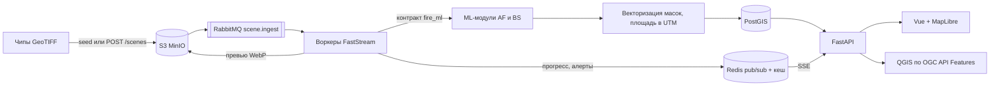

# Зарево - мониторинг природных пожаров по данным ДЗЗ

Решение кейса КосмоХакатона 2026 «Двухэтапный мониторинг природных пожаров». В репозитории два ML-модуля (активное горение по VIIRS, гари и степень поражения по Sentinel) и информационно-аналитический сервис поверх них: карта термоточек, векторные контуры гарей, справка с площадями по степеням, REST API и OGC API Features.

## Запуск сервиса

Нужен Docker с Compose. Выданный набор чипов положите в `DATA/fire-train-renamed/train` (внутри каталоги `af/` и `bs/`), другой путь задаётся переменной `DATA_PATH`.

```bash
docker compose up --build
```

Интерфейс откроется на http://localhost:8080, Swagger на http://localhost:8000/docs. Если порты заняты, поменяйте `WEB_PORT` и `API_PORT` в `.env` (шаблон в `.env.example`).

При первом старте контейнер `seed` загружает чипы в S3 и ставит сцены в очередь. Сцены появляются на карте по мере обработки, ждать конца не нужно. На 4 воркерах (12 ядер, 16 ГБ) весь набор из 420 AF и 224 BS чипов проходит примерно за 5 минут: AF-сцена занимает около 0,2 с, BS-сцена около 1,8 с. Повторный `up` готовые сцены пропускает. Чтобы проверить сервис быстрее, ограничьте сид: `SEED_LIMIT_AF=24 SEED_LIMIT_BS=16`.

Без каталога с данными сервис стартует пустым, чипы можно загрузить через интерфейс (кнопка «Конвейер») или `POST /api/v1/scenes`.

## Как устроен конвейер



Воркер получает сцену из очереди, скачивает растры из S3, вызывает модель, превращает маску в полигоны и пишет результат в PostGIS. Ход каждого задания уходит в Redis и по SSE в интерфейс. После AF-сцены пересчитываются постоянные источники тепла и проверяются зоны наблюдения.

## Что умеет сервис

Запрос задаётся полигоном или прямоугольником плюс интервалом дат. Территорию можно выбрать из списка регионов, нарисовать на карте или назвать текстом агенту («гари в Калмыкии за июнь 2019»).

- Карта термоточек за период. Отфильтрованные срабатывания остаются видны серыми кольцами с причиной: застройка по WorldCover, солнечный блик или постоянный источник («горит в 17 из 18 пролётов за 6 лет»).
- Контуры гарей и полигоны степеней поражения поверх подложки, выгрузка в GeoJSON, Shapefile, GeoPackage и KML. Атрибуты: идентификатор контура, степень, площадь в гектарах, даты съёмки, система координат расчёта.
- Справка: суммарная площадь, распределение по трём степеням и по типам покрова, число очагов, доля отфильтрованных срабатываний, погода в момент детекции. Форматы JSON, CSV, XLSX, PDF.
- Сравнение снимков «до» и «после» шторкой: видимый диапазон, SWIR, радар Sentinel-1, dNBR, наложение степеней.
- Проигрывание периода по дням на шкале времени.
- Метрика кейса `Score = 0.35*F1_af + 0.35*IoU_burn + 0.30*mIoU_sev` прямо в интерфейсе, с микро-усреднением по сценам запроса, для которых есть эталонная маска. Удобно смотреть, где модель ошибается по территории.
- План лесовосстановления по степени и типу покрова: сколько гектаров восстановится само, сколько требует посадок и входит в расчёт ущерба. Ставки в `backend/src/firewatch/assets/restoration_rules.json` условные, замените региональными.
- Зоны наблюдения: новая термоточка природного пожара в зоне даёт алерт в интерфейсе и POST на webhook.

## REST API

Полное описание в Swagger. У каждого аналитического ресурса две формы: `GET` с `bbox` и `POST` с полигоном GeoJSON.

| Метод и путь | Что возвращает |
|---|---|
| `POST /api/v1/query` | термоточки, контуры гарей и справка одним ответом |
| `GET, POST /api/v1/hotspots` | термоточки, `format=geojson,csv`, фильтр `kind` |
| `GET, POST /api/v1/burns` | контуры (`layer=contours`) или степени (`layer=severity`), `format=geojson,shp,gpkg,kml` |
| `GET, POST /api/v1/report` | справка, `format=json,csv,xlsx,pdf` |
| `POST /api/v1/scenes` | загрузка чипа, ответ содержит `job_id` |
| `GET /api/v1/stream` | SSE: задания конвейера и алерты |
| `GET /api/v1/metrics/quality` | метрика кейса по всем сценам с эталоном |
| `GET /api/v1/tiles/burns/{z}/{x}/{y}.mvt` | векторные тайлы гарей |
| `/ogc` | OGC API Features: `hotspots`, `burn_contours`, `burn_severity` |

```bash
# справка по прямоугольнику за сезон 2020
curl "http://localhost:8000/api/v1/report?bbox=44,45.5,47,48.5&date_from=2020-04-01&date_to=2020-10-31"

# контуры гарей по полигону в Shapefile
curl -X POST "http://localhost:8000/api/v1/burns?format=shp" -o burns.zip \
  -H "Content-Type: application/json" \
  -d '{"geometry":{"type":"Polygon","coordinates":[[[44,45.5],[47,45.5],[47,48.5],[44,48.5],[44,45.5]]]},"date_from":"2020-04-01","date_to":"2020-10-31"}'
```

В QGIS: Слой - Добавить слой - WFS / OGC API Features, адрес `http://localhost:8000/ogc`. Слои фильтруются по `bbox` и `datetime` на стороне сервера.

## Как считается площадь

Маска векторизуется по границам пикселей без упрощения, в метрической проекции чипа (EPSG:32637 или EPSG:32638). Поэтому площадь контура равна числу пикселей, умноженному на 0,04 га, и справка сходится с растром. Это закреплено тестом `backend/tests/test_vectorize.py`. Контур на границе запроса обрезается, площадь пересечения пересчитывается в той же UTM-зоне. Гарь попадает в период, если интервал между снимками «до» и «после» пересекается с интервалом запроса.

## Постоянные источники тепла

Газовый факел по одному снимку неотличим от пожара, его выдаёт история. Сервис накапливает детекции и помечает ячейку постоянным источником, если она горела минимум 5 дней за минимум 3 года и не реже чем в 40% пролётов над ней.

Первое правило, 3 дня за 2 года, не сработало: на train оно помечало 175 ячеек, в которых 63% детекций по эталону были настоящими пожарами. Плавни и степь горят в одних местах из года в год, а зимних пролётов, на которых построен эталон, в выборке нет. Доля горящих пролётов отделяет факел от повторяющегося пала гораздо лучше. Пороги лежат в `backend/src/firewatch/config.py` (`persistent_*`).

Наблюдение для ML-части: у ячеек на застройке, которые горят в 16-18 пролётах из 18, эталонная маска часто равна 1. Жёсткая фильтрация застройки может снижать `F1_af`, это стоит проверить на валидации.

## ML-модули

Сервис и модели связаны контрактом в `ml/src/fire_ml/contract.py`. Модель реализует `predict(chip)` и возвращает маску: `ActiveFireModel` бинарную, `BurnSeverityModel` со значениями 0-3. Класс подключается переменной окружения, код сервиса не меняется:

```bash
FIRE_ML_AF=my_package.models:MyActiveFire
FIRE_ML_BS=my_package.models:MyBurnSeverity
```

По умолчанию работает индексный baseline без обучения (`ml/src/fire_ml/baseline.py`): контекстный порог по I4 и I4-I5 для горения, dNBR с порогами по типу покрова для гарей. На всём train он даёт F1_af 0,83, IoU_burn 0,42, mIoU_sev 0,26, Score 0,52. `AfPrediction.codes` необязателен: если модель отдаёт коды отсеянных термоаномалий, сервис покажет их на карте с причиной.

TODO (ML): `inference.py --data-dir ... --output submission.csv`, команда обучения, порядок получения весов, фиксация seed.

## Структура входных данных

```
DATA/fire-train-renamed/train/
  af/  meta.csv  viirs/*_VIIRS_I1-I5.tif  _aux/*_AUX.tif  masks/*_MASK.tif
  bs/  meta.csv  sentinel2_pre/  sentinel2_post/  sentinel1_pre/  sentinel1_post/  _aux/  masks/
```

Геопривязка берётся из самих GeoTIFF. Чип без CRS (тестовый, обезличенный) сервис отклонит с кодом 422: положить его на карту нельзя. Маски необязательны, с ними считается качество на эталоне.

## Структура репозитория

```
ml/                 контракт моделей, чтение чипов, baseline
backend/            FastAPI, конвейер, сервисы запросов и выгрузок, миграции, тесты
  src/firewatch/
    pipeline/       приём сцены: инференс, векторизация, превью, постоянные источники, алерты
    services/       запросы PostGIS, справка, метрики, выгрузки, тайлы
    api/routers/    REST, OGC API Features, SSE
    agent/          агент LangChain и разбор запроса без LLM
frontend/           Vue 3, MapLibre GL, GSAP, shadcn-vue
docker-compose.yml  PostGIS, Redis, RabbitMQ, MinIO, api, worker, seed, web
```

## Разработка

Python-часть собрана как uv workspace с общим `uv.lock`.

```bash
uv sync
uv run pytest
uv run ruff check . && uv run ruff format --check .

cd frontend
npm ci
npm run typecheck && npm run lint
VITE_API_TARGET=http://localhost:8000 npm run dev
```

Агент работает с любым OpenAI-совместимым endpoint (Ollama, vLLM), переменные `LLM_BASE_URL`, `LLM_API_KEY`, `LLM_MODEL`. Без них он разбирает запрос правилами: регион по названию, период по годам, месяцам и сезонам.

## Данные и лицензии

Подложка OpenFreeMap (© OpenMapTiles, данные © OpenStreetMap, ODbL), спутниковая подложка Esri World Imagery. Границы регионов взяты из OpenStreetMap через Nominatim, ODbL. Sentinel-1, Sentinel-2 и Copernicus DEM распространяются по лицензии Copernicus, ESA WorldCover по CC BY 4.0, VIIRS в общественном достоянии (NASA). Выданные организаторами чипы в репозиторий не входят.
