# ML-часть: активное горение и гари

Отчёт по обоим модулям кейса «Двухэтапный мониторинг природных пожаров». Метрика соревнования: `Score = 0.35*F1_af + 0.35*IoU_burn + 0.30*mIoU_sev`, все компоненты считаются микро-усреднением по общему пулу пикселей.

| Модуль | Было (сабмит 0,6098) | Стало | Оценка на валидации |
|---|---|---|---|
| Активное горение, VIIRS | LightGBM по контекстным признакам | без изменений | F1 0,960 |
| Гари и степени, Sentinel | пороги dNBR по типу покрова | LightGBM по пикселям + U-Net MiT-B2 (два сида по пять фолдов) + бустинг второго уровня | IoU 0,736, mIoU 0,703 против 0,434 и 0,283 |

Ожидаемый Score по валидации: 0,35·0,95 + 0,35·0,736 + 0,30·0,703 = 0,80. TODO: вписать public-оценку сабмита `v3_gbm_mitb2x2_stack.csv` после проверки на платформе.

Обе валидации устроены так же, как отделён тест: по территории и по событиям, а не по случайным пикселям. Случайное разбиение завышало бы оценку, потому что соседние пиксели одного пожара попали бы и в обучение, и в проверку.

## Часть 1. Активное горение

### Задача и данные

По чипу 256×256 на сетке 375 м (каналы I1-I5, углы, маска валидности, покров, рельеф, погода) вернуть маску природного горения.

В train 420 чипов, в 296 есть горение. Пикселей горения 9 725, это 0,035% площади, медиана 21 пиксель на положительный чип. 12% горения снято ночью. По покрову: пашня 42%, степь и луга 37%, лес 14%, застройка 3,7%, пойма 2,7%.

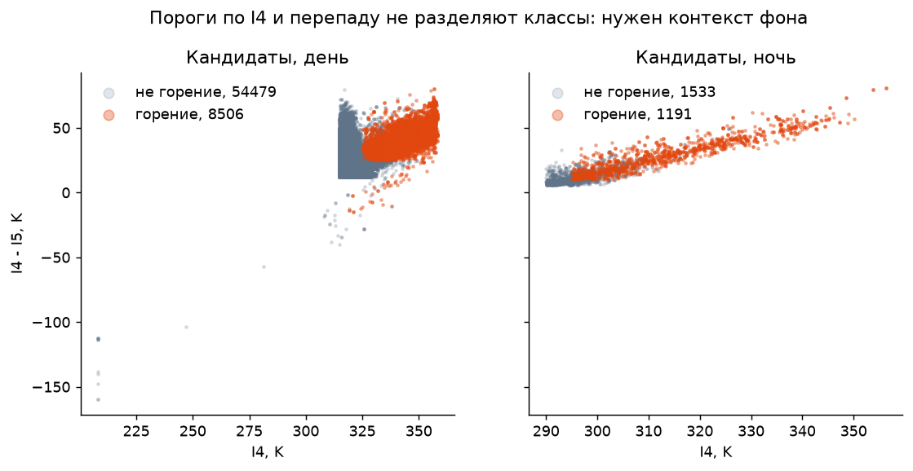

На диаграмме I4 против перепада I4-I5 классы перекрываются и днём, и ночью. Порогами по двум каналам задача не решается, нужен контекст фона. Это же объясняет потолок индексного baseline (F1 0,836).

### Схема решения

Шаг 1, предфильтр кандидатов. Пиксель проходит, если перепад I4-I5 выше фона на 2σ в окне 21, либо I4 > 330 K и перепад > 25 K, либо сработала ветка «заворота» насыщенного I4 (I4 ниже I5 при горячем I5 и насыщенных соседях). Остаётся 65 709 кандидатов, в них 99,71% эталонного горения, потолок F1 0,9986. Доля горения поднимается с 0,035% до 14,8%, поэтому ни веса классов, ни сэмплирование не нужны.

Вторая ветка появилась из разбора потерь: чисто контекстный тест терял 460 дневных пикселей с I4 около 339 K. Это внутренности крупных пожаров, где горячие соседи раздувают разброс фона. Абсолютная ветка вернула их ценой +1% кандидатов.

Шаг 2, LightGBM по 47 признакам, только на кандидатах:

- каналы, перепад, углы, признак ночи (9);
- аномалия и z-оценка I4, I5 и перепада относительно фона в окнах 11, 21 и 41 пиксель, из фона исключены заведомо горячие пиксели, как в VNP14IMG (27);
- горячие соседи и локальные максимумы (6);
- покров, доля застройки и воды в окне 5×5, NDVI, высота (5).

Параметры: 400 деревьев, 31 лист, шаг 0,05, `min_child_samples` 40, subsample и colsample по 0,8, сид 17, `deterministic=True`. Порог 0,38. Один и тот же код считает признаки на обучении и на инференсе: `ml/src/fire_ml/af_features.py`.

### Что дало прирост

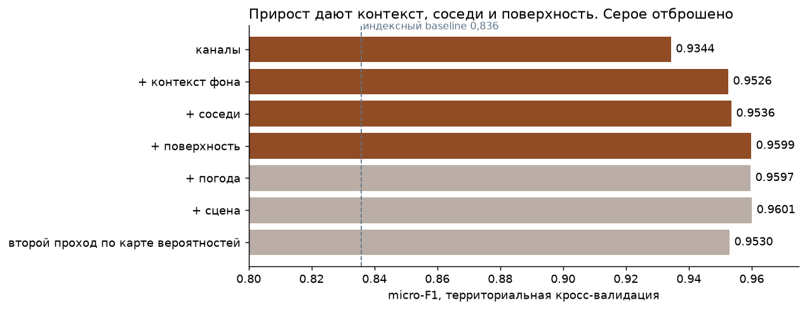

| Набор признаков | F1 | Прирост |
|---|---|---|
| индексный baseline | 0,836 | |
| каналы, углы, день или ночь (9) | 0,9344 | +0,098 |
| + контекст фона (36) | 0,9526 | +0,0182 |
| + соседи (42) | 0,9536 | +0,0010 |
| + поверхность (47) | **0,9599** | +0,0063 |
| + погода ERA5 (50) | 0,9597 | -0,0002, отброшено |
| + признаки сцены (52) | 0,9601 | +0,0004, отброшено |

Разброс по фолдам 0,016, поэтому всё, что меньше, считается шумом. Погода вдобавок привязана к сезону конкретного года, а тест отделён по времени.

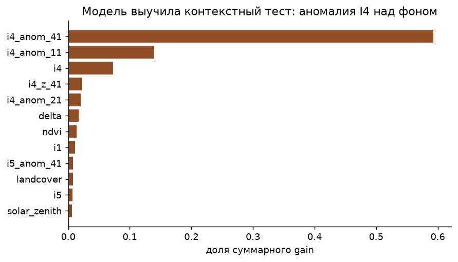

59% суммарного gain даёт аномалия I4 над фоном в окне 41, ещё 14% в окне 11. Модель выучила классический контекстный тест, но с гибкой границей вместо фиксированных порогов.

Не сработало: второй проход по карте вероятностей (0,953, хуже на всех пяти фолдах, потому что эталон построен попиксельно, без логики соседства), деревья глубже (0,9597), усреднение трёх сидов (+0,0003 ценой тройного времени), раздельные пороги дня и ночи (+0,0002). Свёрточную сеть не обучали: 9 725 положительных пикселей мало, а потери лежат не в пространственном рисунке.

### Порог и стабильность

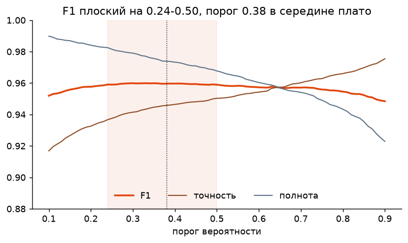

F1 по OOF-вероятностям плоский в диапазоне 0,33-0,43. Порог 0,38 стоит в середине плато: сдвиг распределения вероятностей на тесте в любую сторону стоит меньше 0,001 F1.

| Проверка | F1 |
|---|---|
| территориальная кросс-валидация, 5 фолдов | 0,960 (по фолдам 0,954-0,970) |
| обучение на 2019-2021, проверка на 2023-2024 | 0,950 |
| день / ночь | 0,968 / 0,915 |
| SNPP / NOAA-20 / NOAA-21 | 0,958 / 0,962 / 0,966 |
| 124 чипа без горения | 5 ложных пикселей на все |

Модель устойчивая: перенос на другие годы стоит 0,010, между спутниками разницы нет. На тесте она нашла горение в 136 чипах из 180, доля горящих пикселей 0,033% против 0,035% в train, признаков сдвига распределения нет.

### Остаточные ошибки

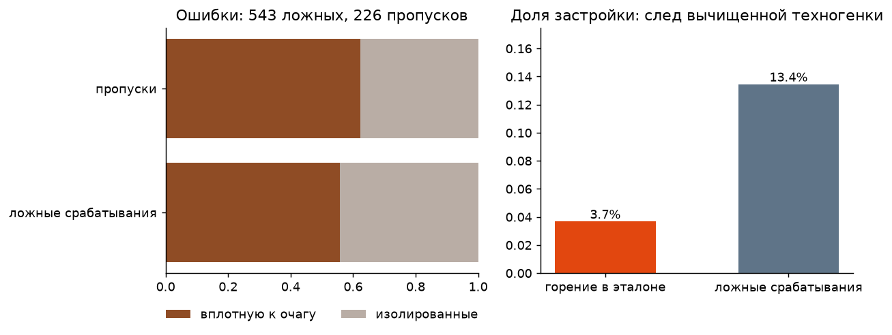

При пороге 0,38 на OOF остаётся 543 ложных срабатывания и 226 пропусков, ещё 28 пикселей теряет предфильтр. Больше половины ошибок лежит вплотную к найденному горению: это сдвиг на границе очага при пересчёте детекций на сетку 375 м, шум разметки. Изолированные ложные срабатывания модель выдаёт уверенно, а доля застройки среди них 13,4% против 3,7% у эталонного горения. Это техногенные источники, убранные из эталона статической картой по координатам. По одному снимку без геопривязки факел от пожара неотличим, а восстанавливать привязку теста запрещено. В сервисе, где привязка есть, эту задачу решает история детекций: `backend/src/firewatch/pipeline/persistence.py`.

Ночью качество ниже (точность 0,879): I4 у горения около 312 K против 339 K днём, зазор до фона меньше.

## Часть 2. Гари и степень поражения

### Задача и данные

По паре снимков Sentinel-2 «до» и «после» (9 каналов и SCL), паре Sentinel-1 (VV, VH), рельефу и покрову отнести каждый пиксель чипа 512×512 на сетке 20 м к одному из четырёх классов: нет гари, слабая, средняя, сильная степень.

В train 224 чипа, гарь занимает 10,1% пикселей: слабая 4,0%, средняя 3,7%, сильная 2,3%. В `meta.csv` есть идентификатор события пожара, по нему сгруппирована валидация.

### Как устроен эталон

Это главное наблюдение по модулю, от него зависит вся архитектура.

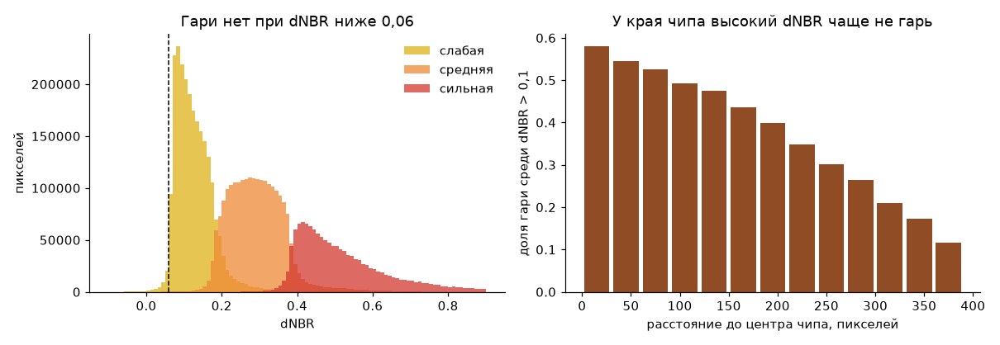

1. Гари не бывает при dNBR ниже 0,06: порог отсекает 67% пикселей и теряет 0,03% гари. Выше 0,08 гарь появляется резко. Это нижний порог автоматической разметки.
2. Степени внутри гари идут по dNBR. Пара порогов 0,185 и 0,386 даёт 90,8% точности, любая другая пара каналов или индекс хуже. До 100% не дотягивает: судя по всему, эталонный NBR считался по 10-метровым каналам и потом огрублялся.
3. Высокий dNBR сам по себе не гарь. Доля гари среди пикселей с dNBR выше 0,1 падает с 57% в центре чипа до 12% в углах. В масках видна ровная дуга окружности: разметка делалась внутри буфера вокруг события пожара, а чип вырезан вокруг этого события.

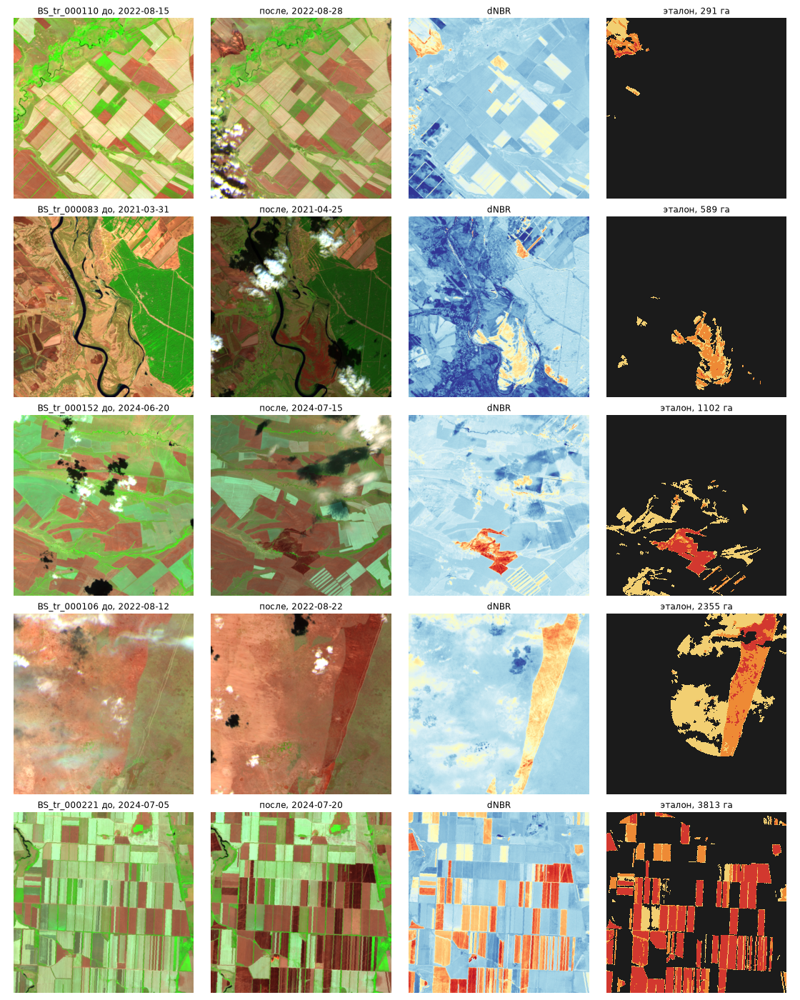

В первой строке убранные поля с высоким dNBR не размечены: они вне буфера. В четвёртой видна круглая граница буфера.

Следствие: степень внутри контура почти восстанавливается по спектру пикселя, а сам контур по спектру не восстановить, нужен пространственный контекст и положение в чипе. Поэтому решение состоит из двух разных моделей и третьей, которая их сводит.

### Схема решения

Шаг 1, предфильтр: `dNBR > 0,06` у пикселя или в среднем по окну 5×5. OOF-метрики от него не меняются ни в одном знаке, а бустинг считает втрое меньше пикселей.

Шаг 2а, LightGBM по пикселям, 86 признаков (`ml/src/fire_ml/bs_features.py`): отражательная способность по 9 каналам до, после и разность; NBR, NBR2, NDVI, NDMI, NDRE, MIRBI и яркость до, после и разность; RBR и RdNBR; VV и VH до и после, сглаженные разности; рельеф, покров, SCL; средние dNBR, dNDVI, NBR и MIRBI в окнах 5, 15 и 41; разброс, максимум и минимум dNBR в окне 5; квантили dNBR по чипу и ранг пикселя внутри чипа. Обучение на всех пикселях гари и 20% фона с весом 5, 300 деревьев на класс, 63 листа.

Шаг 2б, сегментационная сеть: U-Net с энкодером MiT-B2 (SegFormer), вход 45 каналов (`ml/src/fire_ml/bs_tensor.py`), чип целиком 512×512. Функция потерь CE + Dice, AdamW, one-cycle до 3e-4, 60 эпох, bfloat16, аугментации D4. Два сида по пять фолдов. На инференсе усредняются все десять сетей и восемь отражений D4, как при расчёте OOF.

Шаг 3, бустинг второго уровня: на вход вероятности обеих моделей, средняя вероятность гари от сети в окнах 5, 15 и 41, расстояние до центра чипа и несколько исходных признаков. Обучен на OOF-прогнозах первого уровня, 150 деревьев, 31 лист. Итоговый класс выбирается по вероятностям с множителями классов `[1, 1.8, 1.8, 1.8]`: argmax не оптимален для IoU, множители подобраны на OOF.

### Что дало прирост

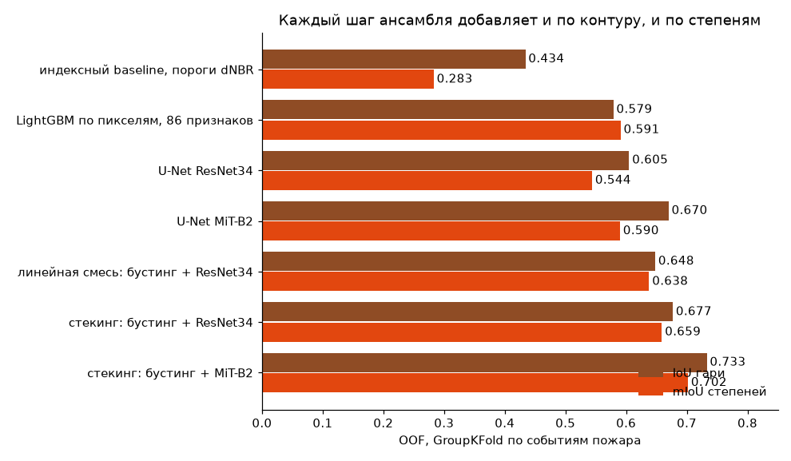

| Вариант | IoU гари | mIoU степеней | IoU по степеням | Вклад в Score |
|---|---|---|---|---|
| индексный baseline | 0,434 | 0,283 | 0,26 / 0,23 / 0,37 | 0,237 |
| LightGBM по пикселям | 0,579 | 0,591 | 0,42 / 0,59 / 0,76 | 0,380 |
| U-Net ResNet34 | 0,605 | 0,544 | 0,38 / 0,55 / 0,69 | 0,375 |
| U-Net MiT-B2 | 0,670 | 0,590 | 0,47 / 0,60 / 0,70 | 0,412 |
| линейная смесь, бустинг + ResNet34 | 0,648 | 0,638 | 0,47 / 0,65 / 0,79 | 0,418 |
| стекинг, бустинг + ResNet34 | 0,677 | 0,659 | 0,53 / 0,66 / 0,79 | 0,435 |
| стекинг, бустинг + MiT-B2 | 0,733 | 0,702 | 0,60 / 0,70 / 0,80 | 0,467 |
| **стекинг, бустинг + MiT-B2, два сида** | **0,736** | **0,703** | 0,62 / 0,70 / 0,80 | **0,469** |

Выводы по шагам.

- Сеть выигрывает у бустинга по контуру (0,670 против 0,579), бустинг у сети по степеням: он ближе к порогам dNBR, которыми степени и размечены.
- Трансформерный энкодер заметно сильнее свёрточного: 0,670 против 0,605 по контуру. MiT видит весь чип сразу, а задача «где здесь событие» глобальная.
- Обучаемое смешивание лучше линейного: +0,017 при тех же моделях первого уровня.
- Положение пикселя в чипе даёт +0,003 во втором уровне.

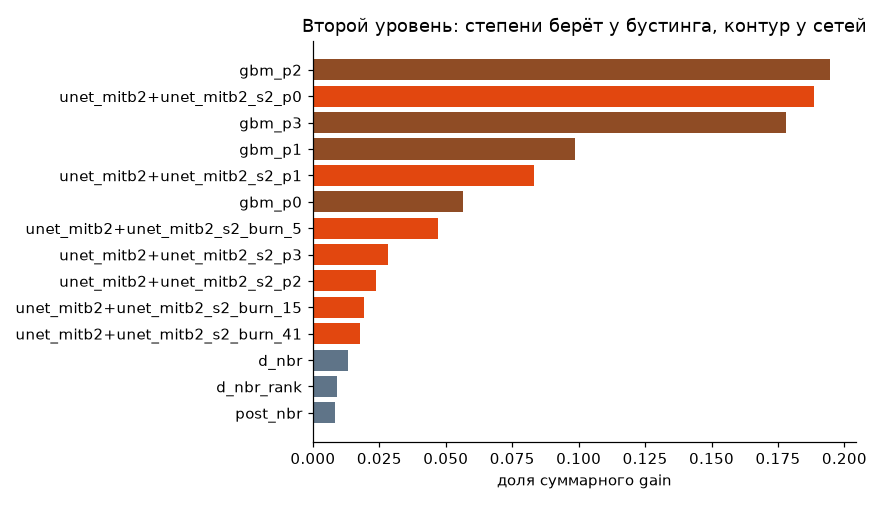

Не сработало: MiT-B3 (по двум фолдам 0,676 и 0,652 против 0,687 и 0,667 у B2 при вдвое большем времени), усреднение ResNet34 с MiT-B2 (0,460 против 0,467), подача сетей раздельными признаками (0,463, в пределах шума). Рядом с MiT-B2 более слабая сеть ничего не добавляет. Второй сид той же MiT-B2 даёт +0,002 на OOF, в четырёх фолдах из пяти в плюс по контуру. Он оставлен: на тесте усредняются все десять сетей, а не одна, как на OOF.

### Примеры и остаточные ошибки

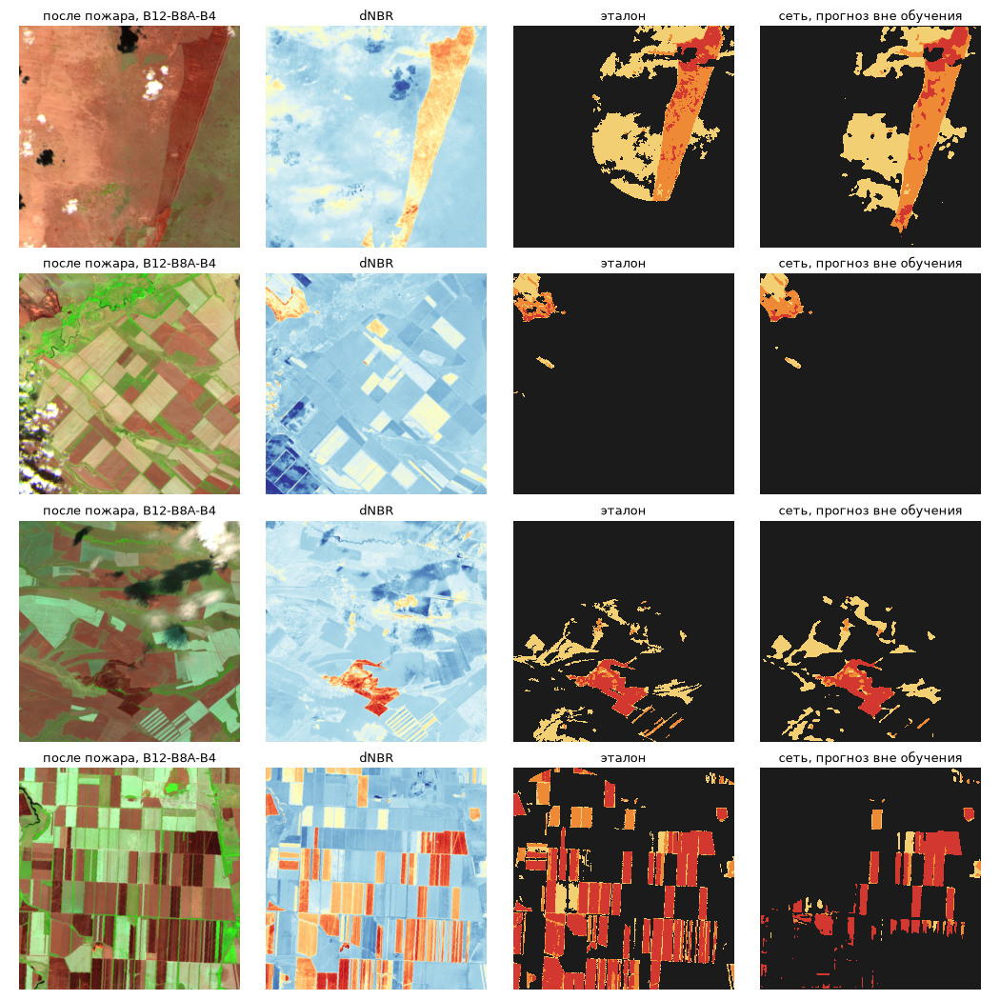

Сеть восстанавливает даже круглую границу буфера (первая строка) и не трогает убранные поля вне события (вторая). Слабое место в четвёртой строке: массовые сельхозпалы, где по снимку не определить, какие из горевших полей попали в буфер события. Такие чипы дают много пикселей и сильно влияют на микро-усреднённый IoU.

### Бюджет ошибки: что мешает выйти выше

Разложение на OOF итогового стекинга (`research/bs/error_budget.py`).

| Вопрос | Ответ |
|---|---|
| точность степени внутри верно найденной гари | 95,8% |
| прирост Score при идеальных степенях и нашем контуре | +0,017 |
| прирост Score при идеальном контуре и наших степенях | +0,15 |
| ошибки контура | 146 тыс. ложных пикселей против 65 тыс. пропущенных на прореженной сетке |
| где они | 62% ложной гари и 70% пропусков на пашне, 30 чипов дают 52% всех ошибок |

Весь резерв в контуре, и он упирается в устройство эталона.

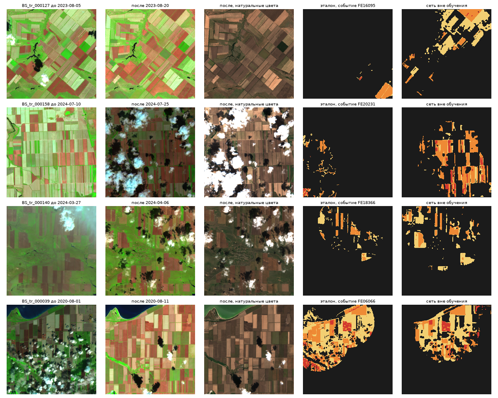

Эталон представляет собой объединение кругов вокруг термоточек события: внутри круга размечено всё с высоким dNBR, включая обычные убранные поля, вне круга ничего (четвёртая строка: два ровных круга). В первой строке круг с центром за краем чипа цепляет один угол, а сеть закрасила убранные поля в другой части кадра. Модель отвечает на вопрос «похоже ли на гарь», эталон на вопрос «попало ли в круг вокруг настоящего очага».

Проверено и не помогло: признаки дальнего контекста во втором уровне (средняя и максимальная вероятность гари в окнах 101 и 201 пиксель, расстояние до уверенного ядра) дали +0,0004; удаление связных пятен без ядра средней или сильной степени дало -0,03, потому что пятна слабой степени внутри круга размечены в эталоне.

Что поможет: больше обучающих чипов. Отличать настоящий очаг, то есть центр круга, от уборки урожая сеть учится по примерам, а их 224. Правила кейса разрешают сбор данных, и схема разметки воспроизводима: архив FIRMS даёт центры, пара снимков Sentinel-2 даёт dNBR с порогами около 0,06, 0,185 и 0,386. Собирать стоит по территориям, заведомо не пересекающимся с тестом.

### Проверка на тесте

На тесте модель отмечает гарью 16,1% пикселей против 10,1% в train. Это согласуется с самими данными: пикселей с dNBR выше 0,386 в тесте 6,1% против 3,9% в train, выше 0,185 их 17,2% против 13,3%. Тест просто содержит больше выгоревшей площади, признаков перебора нет.

### Стабильность

| Модель | IoU гари по фолдам | mIoU по фолдам |
|---|---|---|
| U-Net ResNet34 | 0,544 - 0,681 | 0,496 - 0,573 |
| U-Net MiT-B2 | 0,608 - 0,724 | 0,537 - 0,605 |
| **итоговый стекинг** | **0,689 - 0,798** | **0,667 - 0,767** |

Стекинг по пяти фолдам: 0,714 / 0,749 / 0,689 / 0,798 / 0,724 по контуру и 0,678 / 0,720 / 0,667 / 0,767 / 0,675 по степеням. Худший фолд итоговой модели выше лучшего фолда любой одиночной.

Разброс по фолдам здесь в несколько раз больше, чем в горении (0,10 против 0,016). Причина в микро-усреднении и малом числе событий: один фолд с крупными сельхозпалами сдвигает оценку на несколько сотых. Поэтому ожидаемый результат на тесте стоит читать как 0,73 ± 0,04 по контуру и 0,70 ± 0,04 по степеням, а не как точные числа.

## Воспроизведение

```bash
uv sync --group dl --group research

# горение
uv run python research/af/build_dataset.py
uv run python research/af/experiments.py
PYTHONPATH=research/af uv run python research/af/train.py

# гари
uv run --group research python research/bs/build_dataset.py
uv run --group research python research/bs/experiments.py full
PYTHONPATH=research/bs uv run --group research python research/bs/train_gbm.py
BS_LR=3e-4 uv run --group dl --group research python research/bs/train_cnn.py unet_mitb2 Unet mit_b2 60
BS_SEED=101 BS_LR=3e-4 uv run --group dl --group research python research/bs/train_cnn.py unet_mitb2_s2 Unet mit_b2 60
PYTHONPATH=research/bs uv run --group research python research/bs/stack.py unet_mitb2+unet_mitb2_s2
uv run --group dl python research/bs/export.py unet_mitb2:Unet:mit_b2:unet_mitb2+unet_mitb2_s2 unet_mitb2_s2:Unet:mit_b2:unet_mitb2+unet_mitb2_s2

# сабмит
uv run --group dl python inference.py --data-dir DATA/fire-test-renamed/test --output submission.csv
uv run python validate_submission.py --submission submission.csv --template DATA/fire-test-renamed/test/sample_submission.csv
```

Python 3.13, зависимости зафиксированы в `uv.lock`, torch 2.11 с CUDA 12.8. Обучение сети занимает около 5 минут на фолд на RTX 5070. Инференс всего теста (180 AF и 89 BS чипов) идёт 226 с на RTX 5070 и 12 ядрах, 0,84 с на чип. Основное время уходит на бустинг первого уровня гарей (около 5 с на чип в два потока), десять сетей на GPU занимают 1,2 с на чип. Веса бустингов лежат в репозитории (`ml/src/fire_ml/weights`), веса десяти сетей (528 МБ, fp16) выложены релизом [bs-weights-v1](https://github.com/Mojarung/krasnoyarsk_kosmos/releases/tag/bs-weights-v1), файлы кладутся в `ml/src/fire_ml/weights/`. Без весов сети и без torch модуль гарей автоматически работает на одном бустинге (IoU 0,579, mIoU 0,591), поэтому сервис в Docker от torch не зависит.

Соблюдение правил: геопривязка и даты теста не восстанавливались, готовые продукты по пожарам для ответов на тесте не использовались, тест вручную не размечался. Положение пикселя внутри чипа считается из самого чипа и к географии не привязано.
